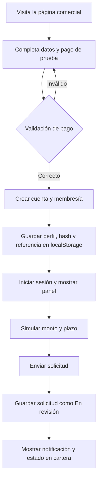

# CréditoYa — MVP web (Emprendimiento UGB)

Sitio demostrativo de **CréditoYa: microcréditos sin fiador**. Incluye la página comercial, checkout de prueba y un panel de cliente con persistencia local.

- `index.html` — página comercial y explicación del servicio.
- `pago.html` — checkout simulado; al completar el pago crea la cuenta y la sesión.
- `cuenta.html` — inicio de sesión y panel para membresía, notificaciones, solicitudes y cartera.
- `js/store.js` — persistencia del MVP en `localStorage`; las contraseñas se guardan como hashes PBKDF2, no en texto plano.

## Probar el MVP

1. Publica el proyecto en HTTPS o sírvelo desde `localhost` (la protección de contraseñas requiere Web Crypto).
2. Desde `index.html`, abre el checkout y completa los datos de cuenta. Para la tarjeta de prueba usa `4242 4242 4242 4242`, cualquier fecha futura y un CVV de 3 dígitos. Cupón: `IMPULSO`.
3. Al confirmar el pago de demostración se crea la cuenta y se inicia sesión. El enlace **Mi cuenta** permite volver al panel; desde ahí también puedes cerrar sesión e iniciar sesión con las credenciales creadas al pagar.
4. Envía una solicitud de microcrédito: aparecerá con estado **En revisión** y una notificación en el panel. Las solicitudes y el estado de la membresía sobreviven al cierre del navegador en el mismo dispositivo.
5. Los datos se pueden borrar desde la configuración de almacenamiento del navegador. La demo no guarda la tarjeta, el CVV ni el DUI.

Todos los cobros, solicitudes y avisos son simulados. No se envían correos/SMS, no hay evaluación de riesgo, aprobación, desembolso, cobros reales ni sincronización entre dispositivos. No utilizar información personal real: `localStorage` es almacenamiento del navegador y no reemplaza un backend seguro.

## Flujo operativo del MVP

## Proveedores, SLA y continuidad

- **Alojamiento previsto:** GitHub Pages, de acuerdo con los pasos de publicación de abajo. Esta versión no cuenta con backend, base de datos central ni SLA propio; el sitio desplegado no procesa datos del navegador.
- **Pago y mensajería:** no hay integración con Stripe, PayPal, Transfer365, SMS o correo. Las opciones de pago y avisos son demostrativas. En producción, integrar un proveedor de pagos y un servicio de correo/SMS mediante backend, revisar sus SLA y no exponer credenciales en el navegador.
- **Contingencia:** conservar el repositorio como fuente de despliegue; ante una caída del hosting, comunicar la interrupción y publicar una copia estática en un hosting alternativo (por ejemplo, Netlify) después de validar DNS y HTTPS. Los datos locales del usuario no estarán disponibles desde otro dispositivo.
- **Soporte:** N1 para acceso y dudas de uso; N2 para problemas de pago o datos; N3 para fallos del sitio. En este prototipo no existe una mesa de ayuda conectada.

## KPIs operativos sugeridos

| KPI | Datos y cálculo | Decisión |
| --- | --- | --- |
| Disponibilidad del sitio | Minutos disponibles / minutos monitoreados × 100; monitoreo externo en el sitio desplegado. | Activar contingencia si incumple el objetivo acordado (por ejemplo, 99.9% mensual). |
| Conversión de pago a cuenta | Cuentas creadas / pagos de prueba iniciados × 100; en producción, eventos del backend sin datos de tarjeta. | Investigar validaciones o pasos con abandono alto. |
| Tiempo de respuesta a solicitud | Hora de decisión menos hora de creación de cada solicitud. | Ajustar capacidad de revisión si se supera el tiempo objetivo de atención. |

Estos KPIs requieren instrumentación de servidor/monitorización para medirse en producción; los datos locales de la demo no se envían a un panel administrativo.

## Publicar en GitHub Pages

1. Crea un repositorio público en GitHub (ej. `creditoya`).
2. Sube **todo el contenido de esta carpeta** a la raíz del repositorio (index.html debe quedar en la raíz).
3. En el repo: **Settings → Pages → Build and deployment → Source: Deploy from a branch**, rama `main`, carpeta `/ (root)` → Save.
4. En 1–2 minutos tu página estará en `https://TU-USUARIO.github.io/creditoya/`.
